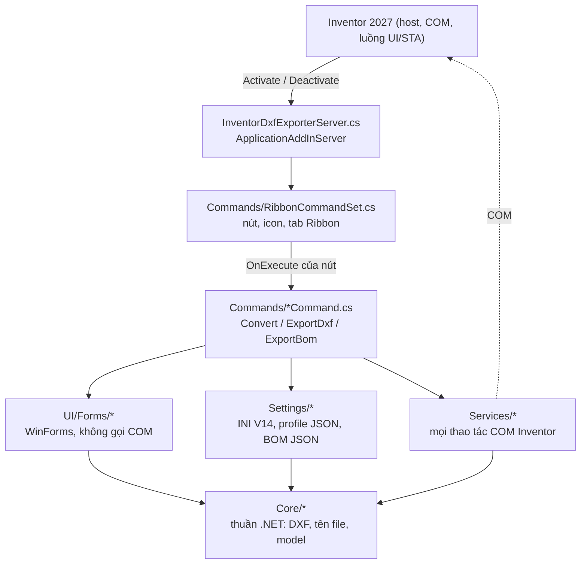
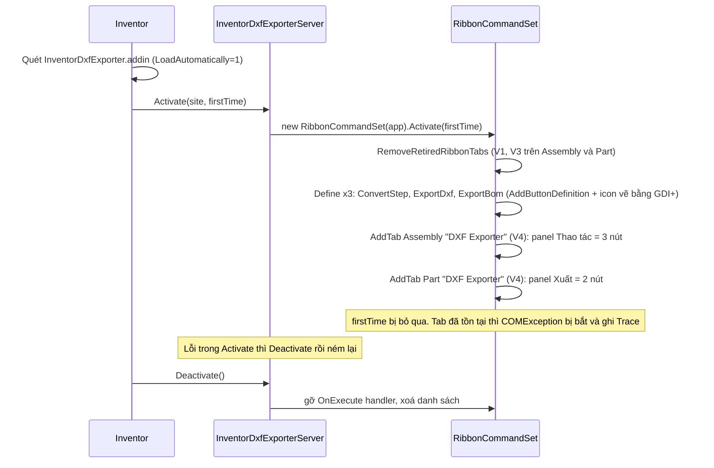
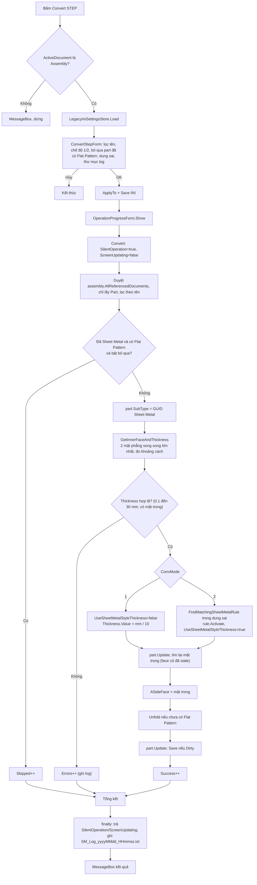
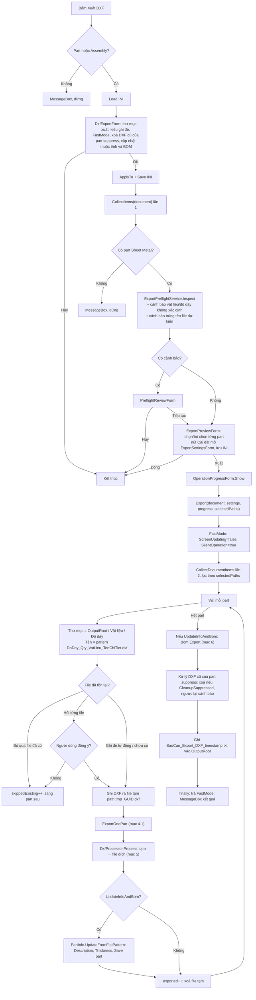
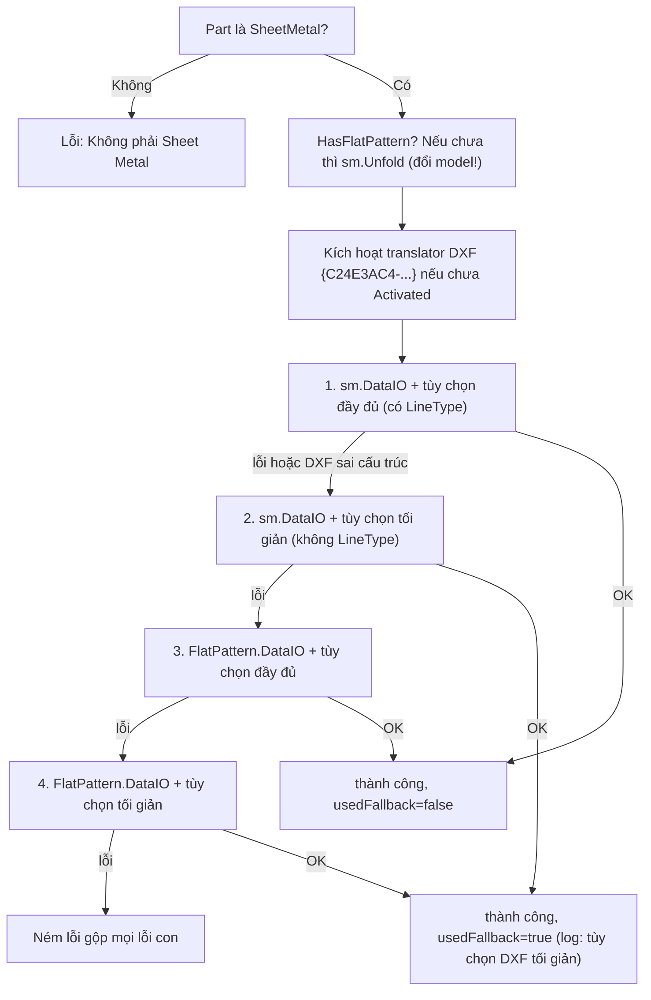
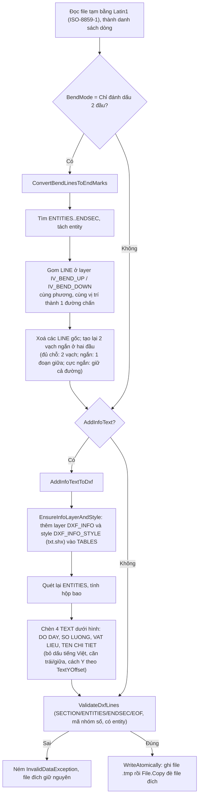
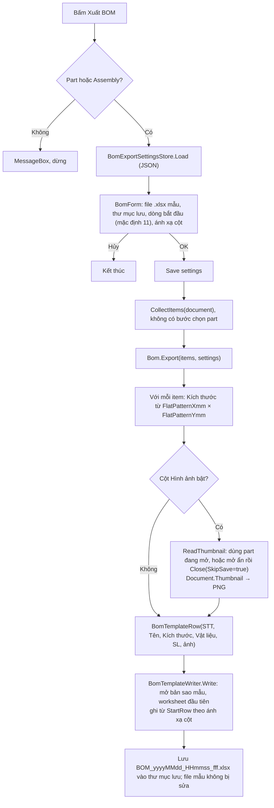
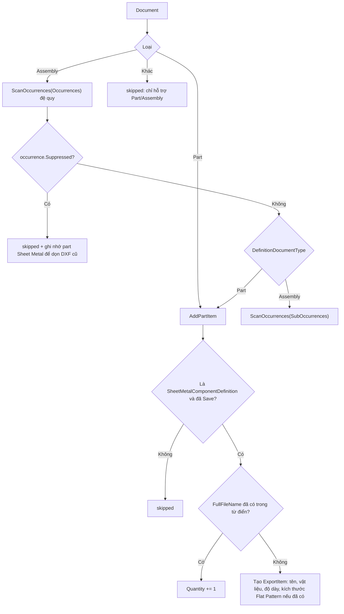

# DXF Exporter Pro — Kiến trúc và luồng hoạt động

Add-in C# / .NET 10 (`net10.0-windows`) cho **Autodesk Inventor 2027**, chuyển từ iLogic V14 (`Source/V14_Original.iLogicVb`, **không sửa**, dùng làm chuẩn đối chiếu hành vi).

Ba chức năng, hiện trên Ribbon:

| Nút | Ngữ cảnh | Việc làm |
|---|---|---|
| Convert STEP | Chỉ Assembly | Đổi các part import (STEP) sang Sheet Metal, đặt Thickness, gán A-Side, tạo Flat Pattern, **Save part** |
| Xuất DXF | Part, Assembly | Xuất DXF từ Flat Pattern, hậu xử lý DXF, (tuỳ chọn) cập nhật Description/Thickness và xuất BOM |
| Xuất BOM | Part, Assembly | Ghi bảng kê vào file Excel mẫu (ClosedXML, không cần Excel) |

---

## 1. Các lớp (layer) và quy tắc phụ thuộc

Quy tắc giữ nguyên khi sửa code:
- `Core/` **không** tham chiếu Inventor/COM (để test được không cần Inventor). `ExportItem` chỉ giữ `DocumentPath` (chuỗi), không giữ đối tượng COM.
- Đối tượng COM (`PartDocument`...) chỉ sống trong `Services/` (`WorkItem` trong `DxfExportServiceImplementation`).
- Mọi gọi COM chạy trên luồng UI của Inventor. Tiến trình báo giữa các mục qua `IOperationMonitor`; `OperationProgressForm.Report` gọi `Application.DoEvents()` và ném `OperationCanceledException` khi bấm Hủy.
- `Skill/` là bộ tài liệu cho AI, bị loại khỏi build (`Compile Remove="Skill\**"`).

---

## 2. Khởi động add-in

- `ClassId`/`ClientId` trong `.addin` = `[Guid]` của class server = `6B93E5C1-9A6A-4D1B-8FA9-47567B4A1D20` (cũng là `ClientId` trong `RibbonCommandSet`). **Phải khớp nhau.**
- Mỗi `*Command` tự tạo một `ServiceContainer` riêng (3 bản, trạng thái không chia sẻ).
- Khi đổi bố cục Ribbon: tăng hậu tố phiên bản (`V4` → `V5`) và thêm tên cũ vào `retiredTabNames`. Xoá tab chỉ theo `InternalName`, không theo tên hiển thị.
- `Define` giữ `ButtonDefinitionSink_Event` + handler trong `_subscriptions` để không bị GC và gỡ được khi `Deactivate`. Lỗi trong lệnh được bắt và hiện MessageBox, không để lọt qua ranh giới COM.

---

## 3. Luồng Convert STEP

`ConvertStepCommand` → `ConvertServiceImplementation`

- **Có tác dụng phụ lên file thật:** đổi SubType, đổi Thickness, tạo Flat Pattern, **Save**. Không có backup.
- Đơn vị: API trả **cm**, UI/BOM/tên file dùng **mm** (nhân/chia 10). `SafeThicknessToCm` xử lý style trả chuỗi kèm đơn vị (`in`, `mm`).
- Hủy giữa chừng: các part đã Save trước đó được giữ nguyên.

---

## 4. Luồng Xuất DXF (luồng chính)

`ExportDxfCommand` → `DxfExportServiceImplementation` → `DxfProcessor`

### 4.1 `ExportOnePart`: chuỗi thử ghi DXF

Mỗi lần thử được kiểm bằng `DxfProcessor.Validate`; thất bại thì xoá file và thử cách kế. Lỗi của các lần thử không được log nếu cuối cùng có một cách thành công.

### 4.2 Chuỗi tùy chọn DXF

`DxfLayerOptionsBuilder.Build(settings, includeLineTypes)` tạo `FLAT PATTERN DXF?AcadVersion=R12&…`:
- 11 layer (Outer, Interior, BendUp, BendDown, ToolCenter, ArcCenters, Tangent, FeatureProfiles, UnconsumedSketches, RollTangent, Roll) ánh xạ khóa → tên layer `IV_*`.
- Layer không được tick vào `InvisibleLayers=a;b;c`. Mặc định chỉ bật Outer + Interior.
- `&RebaseGeometry=True` ở cuối. `LineType` chỉ có ở bản đầy đủ.

---

## 5. Hậu xử lý DXF (`Core/DxfProcessor.cs`)

- Đơn vị DXF là mm (khác với API cm).
- `BendUpLen/Inset`, `BendDownLen/Inset`, `TextHeight`, `TextLineGap`, `TextYOffset` đến từ `ExportSettings`.
- Port nguyên từ V14: khi sửa phải so với `Source/V14_Original.iLogicVb` (các hàm cùng tên).

---

## 6. Luồng Xuất BOM

`ExportBomCommand` → `BomServiceImplementation` → `BomTemplateWriter`

Cột mặc định: STT=A, Tên chi tiết=C, Hình ảnh=D, Kích thước=E, Vật liệu=K, Số lượng=M. Các ô khác của mẫu (tên dự án, ngày…) được giữ nguyên. Trường BOM lạ thì báo lỗi.

---

## 7. Thu thập part (`CollectItems`)

- Khóa duy nhất là `FullFileName` (so sánh không phân biệt hoa thường) → mỗi part một lần, `Quantity` = số occurrence.
- **Không tạo Flat Pattern** ở bước này; chưa có thì kích thước = "Chưa có Flat Pattern". `Unfold` chỉ xảy ra trong `ExportOnePart` hoặc `UpdateFromFlatPattern`.
- Kích thước = hai cạnh lớn nhất của `FlatPattern.RangeBox` (đổi database unit → mm).
- Độ dày: `"T" + Thickness.Value × 10` (mm). Vật liệu: `ActiveMaterial.DisplayName`, mặc định `Khong_Xac_Dinh`.

---

## 8. Cài đặt lưu ở đâu

| Nơi | Đường dẫn | Nội dung |
|---|---|---|
| `LegacyIniSettingsStore` | `%AppData%\Inventor_DXF_Export_Form.ini` | Cài đặt DXF/Convert, tương thích V14 (key=value, `Layer.*`, `LayerStyle.*`) |
| `SettingsProfileStore` | `%AppData%\Inventor_DXF_Exporter\Profiles\<tên>.json` | Cấu hình theo khách hàng/dự án (nạp/lưu/xoá trong ExportSettingsForm) |
| `BomExportSettingsStore` | `%AppData%\Inventor_DXF_Exporter\BomExportSettings.json` | Mẫu Excel, thư mục lưu, dòng bắt đầu, ánh xạ cột; có `SchemaVersion` để migrate |

---

## 9. Build, đóng gói, test

| Việc | Lệnh / file |
|---|---|
| Build + gom DLL | `.\build-and-package.ps1` → `dist\InventorDxfExporter` (copy cả thư mục vào `%APPDATA%\Autodesk\Inventor 2027\Addins`) |
| MSI per-user (WiX 4) | `.\build-installer.ps1` → `dist\InventorDxfExporter-Setup.msi`; cùng UpgradeCode, đóng Inventor trước khi cài |
| Test không cần Inventor | `dotnet run --project .\Tests\DxfProcessorValidation\DxfProcessorValidation.csproj` (validate DXF, layer options, BOM template, migrate settings) |
| Xem trước form | `.\Preview-Settings.ps1` (thư mục `Preview/` có thể không nằm trong bản đang xem) |
| Manifest | `InventorDxfExporter.addin`: `LoadAutomatically=1`, `LoadBehavior=1`, `UseInventorAssemblyContext` đang để mặc định |

Phụ thuộc: ClosedXML 0.104.2 (kèm 6 DLL phụ phải nằm cùng thư mục add-in), `Autodesk.Inventor.Interop.dll` và `stdole.dll` từ `InventorBinPath` (`EmbedInteropTypes=false`, `Private=false`).

---

## 10. Điểm cần nhớ khi sửa code

- Chỉ dùng API Inventor đã xác minh theo `Skill/AGENTS.md` và `Skill/references/API_VERIFICATION.md`. Ghi rõ cái gì build được, cái gì chưa chạy trong Inventor.
- Bộ sưu tập COM đánh chỉ số từ **1**. Đơn vị database = cm.
- Tác dụng phụ lên model/file: `Unfold`, `part.Save()` (Convert, `UpdateFromFlatPattern`), `part.SubType`. Đừng thêm Save ngầm mới.
- Mọi biến đổi DXF qua file tạm; file đích chỉ bị thay sau khi validate xong.
- Giữ trả lại `SilentOperation`/`ScreenUpdating` trong `finally`.
- Tên người dùng thấy (form, báo cáo, log) là tiếng Việt; tên layer/key INI giữ nguyên để tương thích V14.

## 11. Vấn đề đã biết (từ lần kiểm tra ngày 14/11/2026)

1. Báo cáo thực tế cho thấy 60/60 file đều chạy bằng "tùy chọn DXF tối giản": lần thử 1 (có `LineType`) luôn lỗi nhưng lỗi bị nuốt, tốn thời gian (xuất DXF 50,8 s/60 part).
2. `DetailName` lấy từ `part.DisplayName` nên tên file/BOM có hậu tố `(Default)` của Model State.
3. `UpdateInfoAndBom` mặc định `true` nên xuất DXF sẽ Unfold + Save part gốc không backup.
4. Có thể bấm lệnh Ribbon lần hai trong lúc đang chạy (do `DoEvents`).
5. `firstTime` bị bỏ qua và chưa xử lý `OnResetRibbonInterface`.
6. Kích thước BOM (`RangeBox`) và Description (`FlatPattern.Length × Width`) lấy từ hai nguồn khác nhau.
7. `CollectItems` chạy 2–3 lần trên assembly lớn; preflight dùng `AllLeafOccurrences` còn export dùng đệ quy `SubOccurrences`.
8. Chưa có test cho `ConvertBendLinesToEndMarks` và `AddInfoTextToDxf` với DXF thật có TABLES.
9. README còn ghi "chưa compile / chưa chạy trong Inventor"; cần cập nhật theo thực tế.
