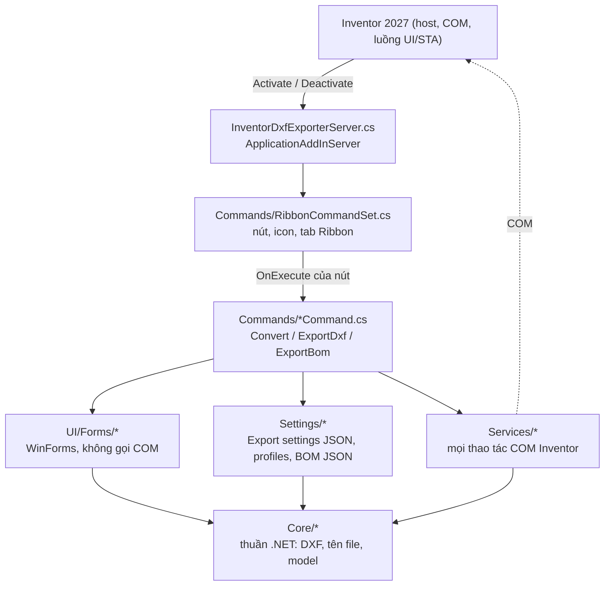
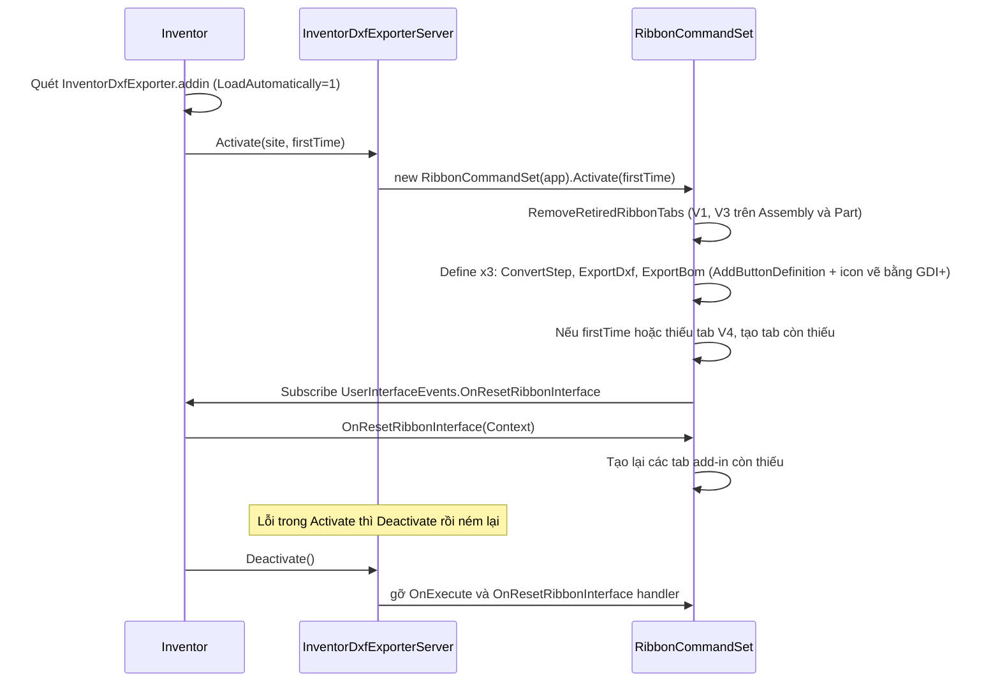
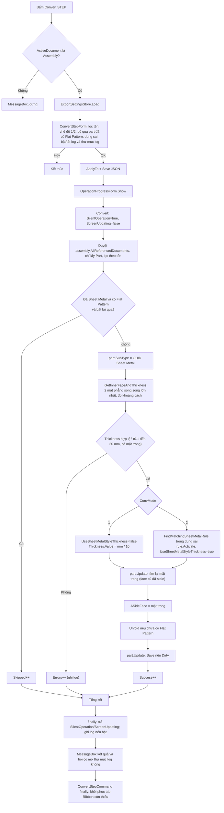
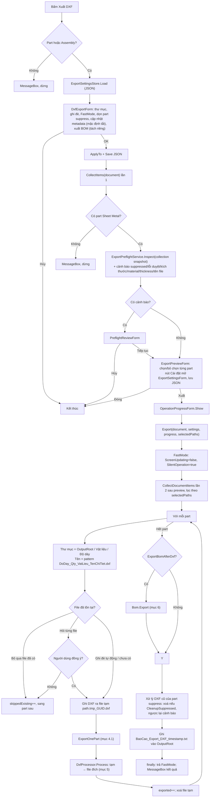
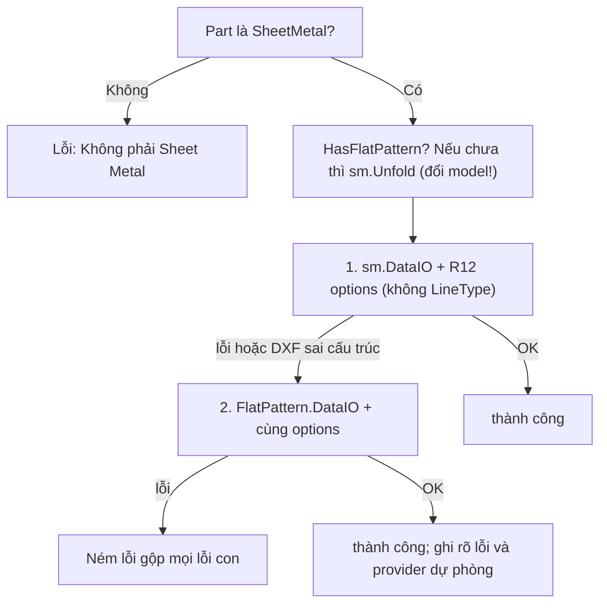
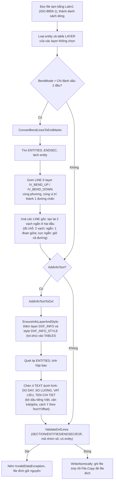
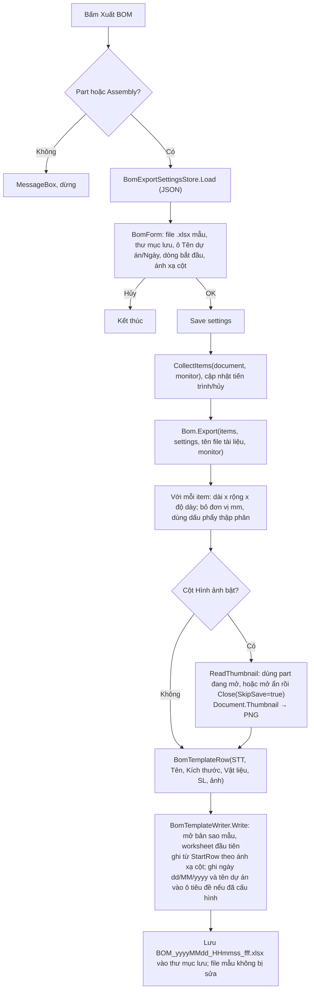
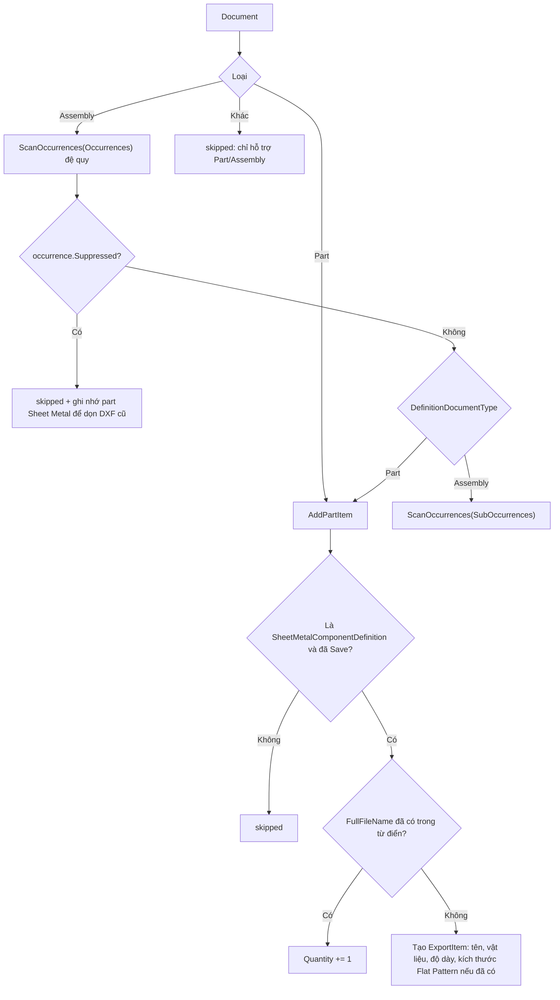

# DXF Exporter Pro — Kiến trúc và luồng hoạt động

Add-in C# / .NET 10 (`net10.0-windows`) độc lập cho **Autodesk Inventor 2027**. Mã nguồn add-in hiện tại là nguồn chuẩn để phát triển và kiểm thử.

Ba chức năng, hiện trên Ribbon:

| Nút | Ngữ cảnh | Việc làm |
|---|---|---|
| Convert STEP | Chỉ Assembly | Đổi các part import (STEP) sang Sheet Metal, đặt Thickness, gán A-Side, tạo Flat Pattern, **Save part** |
| Xuất DXF | Part, Assembly | Xuất DXF từ Flat Pattern, hậu xử lý DXF và (tuỳ chọn) xuất BOM; không cập nhật thuộc tính hoặc lưu part nguồn |
| Xuất BOM | Part, Assembly | Ghi bảng kê vào file Excel mẫu (ClosedXML, không cần Excel) |

---

## 1. Các lớp (layer) và quy tắc phụ thuộc

Quy tắc giữ nguyên khi sửa code:
- `Core/` **không** tham chiếu Inventor/COM (để test được không cần Inventor). `ExportItem` chỉ giữ `DocumentPath` (chuỗi), không giữ đối tượng COM.
- Thay đổi hành vi phải được kiểm tra bằng build/test và trên Inventor 2027 khi có liên quan đến host.
- Đối tượng COM (`PartDocument`...) chỉ sống trong `Services/` (`WorkItem` trong `DxfExportServiceImplementation`).
- Mọi gọi COM chạy trên luồng UI của Inventor. Tiến trình báo giữa các mục qua `IOperationMonitor`; `OperationProgressForm.Report` gọi `Application.DoEvents()` và ném `OperationCanceledException` khi bấm Hủy.
- `Skill/` là bộ tài liệu cho AI, bị loại khỏi build (`Compile Remove="Skill\**"`).

---

## 2. Khởi động add-in

- `ClassId`/`ClientId` trong `.addin` = `[Guid]` của class server = `6B93E5C1-9A6A-4D1B-8FA9-47567B4A1D20` (cũng là `ClientId` trong `RibbonCommandSet`). **Phải khớp nhau.**
- Mỗi `*Command` tự tạo một `ServiceContainer` riêng (3 bản, trạng thái không chia sẻ). Bộ chặn dùng chung ngăn chạy lệnh thứ hai khi `DoEvents` nhường UI.
- Khi đổi bố cục Ribbon: tăng hậu tố phiên bản (`V4` → `V5`) và thêm tên cũ vào `retiredTabNames`. Xoá tab chỉ theo `InternalName`, không theo tên hiển thị.
- `Define` giữ `ButtonDefinitionSink_Event` + handler trong `_subscriptions` để không bị GC và gỡ được khi `Deactivate`. Lỗi trong lệnh được bắt và hiện MessageBox, không để lọt qua ranh giới COM.

---

## 3. Luồng Convert STEP

`ConvertStepCommand` → `ConvertServiceImplementation`

- **Có tác dụng phụ lên file thật:** đổi SubType, đổi Thickness, tạo Flat Pattern, **Save**. Không có backup.
- Ghi log mặc định bật để giữ hành vi cũ; có thể tắt trong form. Chỉ hỏi mở thư mục sau khi log đã ghi thành công.
- Đơn vị: API trả **cm**, UI/BOM/tên file dùng **mm** (nhân/chia 10). `SafeThicknessToCm` xử lý style trả chuỗi kèm đơn vị (`in`, `mm`).
- Hủy giữa chừng: các part đã Save trước đó được giữ nguyên.

---

## 4. Luồng Xuất DXF (luồng chính)

`ExportDxfCommand` → `DxfExportServiceImplementation` → `DxfProcessor`

### 4.1 `ExportOnePart`: chuỗi thử ghi DXF

Mỗi lần thử được kiểm bằng `DxfProcessor.Validate`; thất bại thì xoá file và thử provider kế. Không thử lại cùng provider với option khác. Kết quả fallback ghi rõ lỗi provider đầu trong báo cáo.

### 4.2 Chuỗi tùy chọn DXF

`DxfLayerOptionsBuilder.Build(settings)` tạo `FLAT PATTERN DXF?AcadVersion=R12&…`:
- 11 layer có khóa cấu hình (Outer, Interior, BendUp, BendDown, ToolCenter, ArcCenters, Tangent, FeatureProfiles, UnconsumedSketches, RollTangent, Roll) ánh xạ sang tên `IV_*`; `IV_MARK_SURFACE` là tùy chọn layer riêng, mặc định tắt và không cần thêm tham số ánh xạ.
- Layer không được tick được đưa vào `InvisibleLayers=a;b;c` và bị loại hậu xử lý khỏi entity/table LAYER của DXF. Vì vậy CAD không còn liệt kê tên layer chưa chọn. Mặc định chỉ bật Outer + Interior. Khi Tool Center tắt, lọc cả `IV_TOOL_CENTER` và biến thể `IV_Tool_center`.
- `&RebaseGeometry=True` ở cuối. `LineType` được bỏ khỏi luồng xuất chính vì log thực tế cho thấy option này khiến 60/60 part phải thử lại.

---

## 5. Hậu xử lý DXF (`Core/DxfProcessor.cs`)

- Đơn vị DXF là mm (khác với API cm).
- `BendUpLen/Inset`, `BendDownLen/Inset`, `TextHeight`, `TextLineGap`, `TextYOffset` đến từ `ExportSettings`.
- Mã nguồn add-in hiện tại là nguồn chuẩn; không phụ thuộc vào một iLogic source bên ngoài.

---

## 6. Luồng Xuất BOM

`ExportBomCommand` → `BomServiceImplementation` → `BomTemplateWriter`

Cột mặc định: STT=A, Tên chi tiết=C, Hình ảnh=D, Kích thước=E, Vật liệu=K, Số lượng=M. Địa chỉ ô tiêu đề cho ngày và tên dự án cấu hình độc lập; để trống thì không ghi. Tên dự án lấy từ tên file tài liệu không gồm phần mở rộng. Các ô khác của mẫu được giữ nguyên. Tiến trình có thể hủy giữa các mục; `SaveAs` của ClosedXML là đồng bộ nên không báo tiến trình giữa lúc lưu.

---

## 7. Thu thập part (`CollectItems`)

- Khóa duy nhất là `FullFileName` (so sánh không phân biệt hoa thường) → mỗi part một lần, `Quantity` = số occurrence.
- **Không tạo Flat Pattern** ở bước này; chưa có thì kích thước = "Chưa có Flat Pattern". `Unfold` chỉ xảy ra trong `ExportOnePart`.
- Kích thước = hai cạnh lớn nhất của `FlatPattern.RangeBox` (đổi database unit → mm).
- Độ dày: `"T" + Thickness.Value × 10` (mm). Vật liệu: `ActiveMaterial.DisplayName`, mặc định `Khong_Xac_Dinh`.

---

## 8. Cài đặt lưu ở đâu

| Nơi | Đường dẫn | Nội dung |
|---|---|---|
| `ExportSettingsStore` | `%AppData%\Inventor_DXF_Exporter\ExportSettings.json` | Cài đặt DXF/Convert dạng JSON |
| `SettingsProfileStore` | `%AppData%\Inventor_DXF_Exporter\Profiles\<tên>.json` | Cấu hình theo khách hàng/dự án (nạp/lưu/xoá trong ExportSettingsForm) |
| `BomExportSettingsStore` | `%AppData%\Inventor_DXF_Exporter\BomExportSettings.json` | Mẫu Excel, thư mục lưu, dòng bắt đầu, ánh xạ cột; có `SchemaVersion` để migrate |

Các thư mục build (`bin/`, `obj/`, `dist/`) là output cục bộ, không phải nguồn phát hành. Luồng phát hành duy nhất là MSI; `build-installer.ps1` giữ output trung gian trong thư mục tạm và chỉ xuất MSI vào `dist/`.
`Examples/AssemblyImageExport.iLogicVb` là rule iLogic độc lập để tham khảo, không được add-in sử dụng hay đóng gói.

---

## 9. Build, đóng gói, test

| Việc | Lệnh / file |
|---|---|
| Build và đóng gói MSI per-user (WiX 4) | `.\build-installer.ps1` → `dist\InventorDxfExporter-Setup.msi`; cùng UpgradeCode, đóng Inventor trước khi cài |
| Test không cần Inventor | `dotnet run --project .\Tests\DxfProcessorValidation\DxfProcessorValidation.csproj` (validate DXF, layer options, JSON settings, BOM template/metadata/dimensions) |
| Xem trước form | `.\Preview-Settings.ps1` (thư mục `Preview/` có thể không nằm trong bản đang xem) |
| Manifest cài cùng MSI | `InventorDxfExporter.addin`: `LoadAutomatically=1`, `LoadBehavior=1`, `UseInventorAssemblyContext` đang để mặc định |

Phụ thuộc: ClosedXML 0.104.2 và các DLL phụ được đóng gói trong MSI; `Autodesk.Inventor.Interop.dll` và `stdole.dll` được tham chiếu từ `InventorBinPath` (`EmbedInteropTypes=false`, `Private=false`).

---

## 10. Điểm cần nhớ khi sửa code

- Chỉ dùng API Inventor đã xác minh theo `Skill/AGENTS.md` và `Skill/references/API_VERIFICATION.md`. Ghi rõ cái gì build được, cái gì chưa chạy trong Inventor.
- Bộ sưu tập COM đánh chỉ số từ **1**. Đơn vị database = cm.
- Convert STEP có tác dụng phụ lên model/file: đổi `SubType`, đặt Thickness, tạo Flat Pattern và Save part. Xuất DXF có thể tạo Flat Pattern trong phiên làm việc nhưng không cập nhật Description/Thickness và không gọi Save part.
- Mọi biến đổi DXF qua file tạm; file đích chỉ bị thay sau khi validate xong.
- Giữ trả lại `SilentOperation`/`ScreenUpdating` trong `finally`.
- Tên người dùng thấy (form, báo cáo, log) là tiếng Việt.

## 11. Kết quả rà soát ngày 15/11/2026

- Đã loại `LineType` khỏi option DXF chính và chỉ thử từng provider một lần; fallback provider/lỗi được ghi trong báo cáo.
- Tên chi tiết lấy từ tên file, không từ `DisplayName` có thể gắn Model State.
- Xuất DXF không cập nhật Description/Thickness và không lưu part nguồn. BOM sau DXF là lựa chọn riêng, mặc định tắt.
- Tiến trình vẫn dùng `DoEvents` để cập nhật UI, nhưng chặn lệnh Ribbon chạy lồng nhau.
- Ribbon dùng `firstTime`, kiểm tra tab hiện hữu và tái tạo tab thiếu sau `OnResetRibbonInterface`.
- BOM và Description đọc chung kích thước từ `FlatPattern.RangeBox`; khi xuất DXF tạo Flat Pattern mới, dữ liệu BOM được làm mới sau khi Unfold.
- Preflight dùng danh sách đã thu thập, tránh lượt duyệt assembly COM thứ hai. Lượt export vẫn duyệt lại sau bước preview để lấy trạng thái tài liệu hiện thời.
- Đã thêm kiểm tra hậu xử lý bend/TEXT trên DXF fixture có TABLES. Hình học của các đoạn bend rời không được thay đổi theo yêu cầu người dùng.
- Build add-in, test tự động và MSI đã chạy thành công trên mã nguồn hiện tại. WiX build không còn cảnh báo: bỏ override `REINSTALLMODE` để xử lý ICE40, không cho nâng cấp cùng phiên bản để xử lý ICE61, và suppress ICE91 vì gói cố ý cài vào thư mục Add-ins per-user khớp với `Scope="perUser"`. Người dùng xác nhận add-in đã chạy thử thành công trong Inventor 2027; cần xác nhận việc đọc/ghi cấu hình JSON và cài/nâng cấp/gỡ MSI trên host/máy thử sạch trước khi phát hành.
